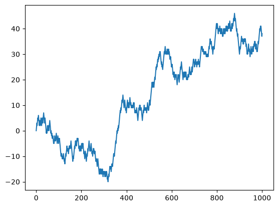
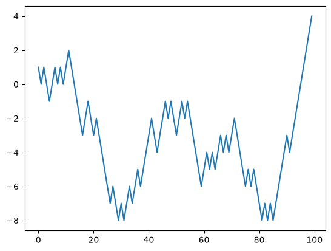
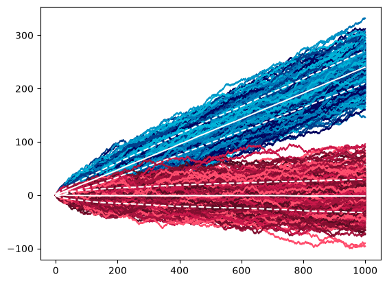
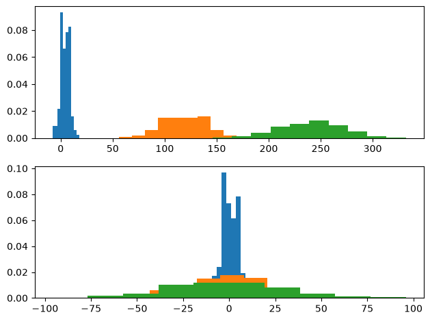
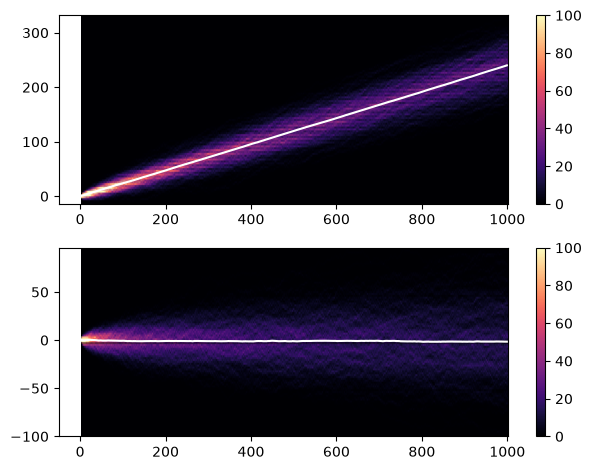
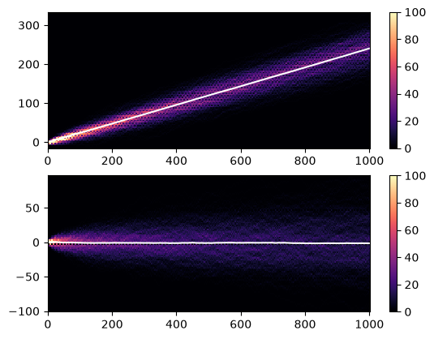
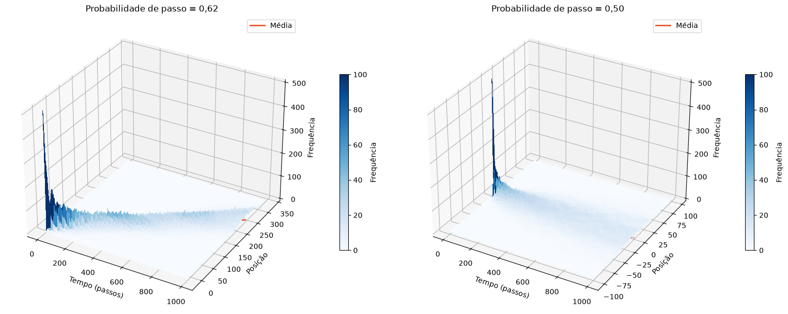

# Lista 2 — Caminhadas Aleatórias

## Relatório acadêmico-didático

### 1. Contextualização e objetivo

Este trabalho investiga o processo estocástico conhecido como **caminhada aleatória unidimensional** (ou *random walk*). Em cada instante discreto, uma partícula realiza um deslocamento unitário para a direita ou para a esquerda. Assim, a caminhada constitui um modelo simples de fenômenos físicos nos quais o movimento resulta de colisões sucessivas ou de flutuações aleatórias.

São analisadas duas situações:

- **Caminhada viesada**, em que a probabilidade de mover-se para a direita é $p>0{,}50$;
- **Caminhada simétrica**, em que $p=0{,}50$.

No conjunto de exercícios implementado no notebook `Lista2.ipynb`, foram construídas trajetórias individuais, versões vetorizadas para um conjunto de partículas, histogramas de posições, mapas de calor e superfícies tridimensionais da evolução temporal da distribuição.

### 2. Modelo matemático

Considere uma caminhada em que, em cada passo $n$, a variável aleatória $\xi_n$ assume os valores

$$
\xi_n =
\begin{cases}
+1, & \text{com probabilidade } p,\\
-1, & \text{com probabilidade } 1-p.
\end{cases}
$$

A posição da partícula após $N$ passos é

$$
X_N=X_0+\sum_{n=1}^{N}\xi_n,
$$

com posição inicial $X_0=0$. Para uma caminhada com um número par de passos, o valor final pertence ao conjunto dos números pares, pois cada passo altera a posição em uma unidade e a soma final pode ser escrita como

$$
X_N=2N_R-N,
$$

em que $N_R$ é o número de passos à direita.

Para a versão isotrópica, $p=1/2$, o valor médio do deslocamento é zero:

$$
\langle X_N\rangle = N(p-(1-p))=N(2p-1)=0.
$$

Entretanto, a dispersão cresce com o tempo. Para incrementos independentes,

$$
\langle X_N^2\rangle=N
$$

e

$$
\sigma_X=\sqrt{N},
$$

em unidades em que o comprimento de cada passo é unitário.

Para uma caminhada viesada com $p=0{,}62$, espera-se uma deriva média

$$
\langle X_N\rangle=N(2p-1)=0{,}24N.
$$

Dessa forma, após 1000 passos, a posição média teórica esperada é aproximadamente $240$ unidades.

### 3. Implementação computacional e variáveis

O notebook utiliza as seguintes bibliotecas:

- `numpy`: geração de números aleatórios, cálculos vetoriais e histogramas.
- `matplotlib.pyplot`: gráficos bidimensionais e superfícies tridimensionais.
- `cycler`: definição dos ciclos de cores das trajetórias.
- `plotly.graph_objects` e `plotly.subplots`: construção da visualização interativa tridimensional.

O gerador é definido por

```python
rng = np.random.default_rng()
```

A variável `rng` encapsula o gerador moderno de números pseudoaleatórios do NumPy. O uso de um gerador explícito diferencia esta implementação das funções legadas baseadas em `np.random.random` e permite controlar o estado do processo aleatório da simulação.

#### Principais variáveis

| Variável | Representação |
|---|---|
| `probabilidade` ou `p` | Probabilidade $p$ de cada passo ser $+1$; a probabilidade de $-1$ é $1-p$. |
| `passos` | Número de passos temporais da caminhada. |
| `bebados` | Número de caminhantes independentes presentes no ensemble. |
| `x` | Lista com a posição da caminhada lenta em cada instante. |
| `r` | Número uniforme sorteado por `rng.random()`, usado para decidir o sentido do passo. |
| `traj` | Trajetória cumulativa de uma caminhada rápida ou matriz com todas as trajetórias. |
| `passos` em `randomwalkrapido` | Vetor de incrementos $+1$ ou $-1$ sorteados pelo NumPy. |
| `trajetoria` | Soma cumulativa dos incrementos ao longo do tempo. |
| `media1`, `media2` | Médias das posições do ensemble em cada instante, respectivamente para $p=0{,}62$ e $p=0{,}50$. |
| `desviopadrao1`, `desviopadrao2` | Desvio padrão das posições no ensemble em cada instante. |
| `x1`, `x2` | Matrizes cujas linhas representam o tempo e cujas colunas representam caminhantes. |
| `num_bins` | Número de intervalos usados para construir os histogramas temporais. |
| `bin_edges1`, `bin_edges2` | Limites dos bins das distribuições para $p=0{,}62$ e $p=0{,}50$. |
| `hist1`, `hist2` | Contagens de caminhantes por intervalo de posição e instante de tempo. |
| `tempo1`, `tempo2` | Malhas bidimensionais do eixo temporal usadas nas superfícies. |
| `posicoes1`, `posicoes2` | Malhas bidimensionais das posições usadas nas superfícies. |

## 4. Questões 1 e 2 — implementação das caminhadas

### 4.1 Caminhada lenta

A função `randomwalklento(probabilidade, passos)` constrói uma lista começando em zero. Em cada iteração:

1. é sorteado um número aleatório $r$;
2. se $r\geq 1-p$, soma-se $+1$;
3. caso contrário, soma-se $-1$.

Na prática, a condição acima é equivalente a sortear $+1$ com probabilidade $p$. Para $p=0{,}53$, a caminhada apresenta uma ligeira preferência para a direita.



A trajetória apresenta oscilações em pequenas escalas, mas a assimetria global pode produzir um deslocamento médio positivo em uma realização suficientemente longa.

### 4.2 Caminhada rápida

A função `randomwalkrapido(probabilidade, passos)` recebe a probabilidade e utiliza `rng.choice` para sortear diretamente todos os incrementos:

$$
\Delta X_i\in\{-1,+1\}.
$$

O vetor é construído com `size=100`, independentemente do argumento `passos` fornecido na implementação original. Em seguida, `np.cumsum` transforma os incrementos nas posições sucessivas:

$$
X_n=\sum_{i=1}^{n}\Delta X_i.
$$



Essa forma é mais eficiente do que um loop em Python, pois delega o sorteio e a soma cumulativa a operações vetorizadas do NumPy.

## 5. Questões 3, 4 e 5 — ensemble, média e desvio padrão

Na versão vetorizada da função, `rng.choice` recebe

```python
size=[passos, bebados]
```

como tamanho. O resultado possui uma matriz de incrementos com `passos` linhas e `bebados` colunas. Cada linha representa um instante e cada coluna representa um caminhante. A função `np.cumsum(..., axis=0)` acumula os incrementos ao longo das linhas, preservando uma coluna por caminhante.

Antes da acumulação, o conjunto apresenta inicialmente uma matriz com 500 caminhantes em todos os passos. Depois da operação `np.vstack` da origem, `x1` e `x2` passam a conter inclusive a linha inicial correspondente ao tempo $t=0$.

A média em cada instante é calculada como

$$
\mu_X(t)=\frac{1}{N_b}\sum_{j=1}^{N_b}X_j(t),
$$

em que $N_b=500$ é o número de caminhantes. O desvio padrão é

$$
\sigma_X(t)=\sqrt{\frac{1}{N_b}\sum_{j=1}^{N_b}\left[X_j(t)-\mu_X(t)\right]^2}.
$$

O gráfico compara:

- cinco trajetórias azuis, para $p=0{,}62$;
- cinco trajetórias rosadas, para $p=0{,}50$;
- a média em branco;
- os limites $\mu_X\pm\sigma_X$ em linhas tracejadas.



Para $p=0{,}62$, observa-se deriva contínua para posições positivas. Para $p=0{,}50$, a média permanece próxima de zero, enquanto as trajetórias individuais podem se afastar da origem devido ao caráter aleatório do processo.

## 6. Questão 6 — distribuição em instantes selecionados

Para analisar o espalhamento coletivo, o notebook extrai linhas da matriz de trajetórias:

- `x1[20]` e `x2[20]`: posições de 500 caminhantes no passo 20;
- `x1[500]` e `x2[500]`: posições no passo 500;
- `x1[-1]` e `x2[-1]`: posições no último passo calculado.

O método `plt.hist(..., density=True)` constrói histogramas normalizados. Assim, a área de cada histograma é próxima de uma unidade e os resultados podem ser interpretados como estimativas de densidade de probabilidade.



O deslocamento da distribuição viesada é visível em relação ao caso simétrico. A distribuição simétrica tende a manter o centro próximo de zero, mas apresenta maior diversidade de posições à medida que o tempo cresce.

## 7. Questão 7 — evolução da distribuição

### 7.1 Construção dos histogramas bidimensionais

O notebook define 100 intervalos de posição por meio de `np.linspace`. Para cada instante de tempo, `np.histogram` conta quantos caminhantes se encontram em cada intervalo:

$$
H(t,b)=\#\{j: x_b\leq X_j(t)<x_{b+1}\},
$$

em que $H(t,b)$ é a contagem no tempo $t$ e no bin $b$.

As matrizes `hist1` e `hist2` são organizadas com:

- linhas: tempo;
- colunas: posição/intervalo;
- elementos: frequência ou número de caminhantes.

### 7.2 Mapa de calor

Os mapas de calor da matriz transposta mostram posição no eixo vertical e tempo no eixo horizontal. A coloração representa a frequência da posição no ensemble. A curva branca identifica a posição média em cada instante.

As duas versões abaixo correspondem às representações `imshow` e `pcolormesh` utilizadas no notebook:





No caso $p=0{,}62$, a região de maior frequência desloca-se continuamente para posições positivas. No caso $p=0{,}50$, a região de concentração permanece centrada próximo de zero, ao mesmo tempo que se amplia com o tempo.

### 7.3 Representação tridimensional

Para representar simultaneamente tempo, posição e frequência, o notebook cria malhas com `np.meshgrid`. A matriz `hist1.T` ou `hist2.T` fornece a terceira dimensão da superfície.

No gráfico, os eixos representam:

- eixo $x$: tempo em passos;
- eixo $y$: posição da caminhada;
- eixo $z$: frequência encontrada no ensemble;
- cor da superfície: mesma quantidade representada no eixo $z$.

A linha vermelha representa a média da posição em função do tempo.



A comparação tridimensional torna evidente a tendência central dos processos: o pico da caminhada viesada acompanha uma reta ascendente, enquanto o caso simétrico tende a permanecer próximo de zero e apenas se espalhar lateralmente.

## 8. Visualização interativa com Plotly

A última parte do notebook converte as duas superfícies em objetos gráficos interativos. `make_subplots` cria dois painéis do tipo `surface`, um para cada probabilidade. A classe `go.Surface` recebe:

- `x=tempo1[0, :]`: eixo temporal;
- `y=posicoes1[:, 0]`: eixo das posições;
- `z=hist1.T`: frequência para cada par tempo–posição;
- `colorscale='Blues'`: escala cromática da frequência;
- `cmin=0` e `cmax=100`: limites da barra de cores.

Também são adicionadas linhas `go.Scatter3d` para mostrar a média. `media1[:, 0]` contém as médias sucessivas para $p=0{,}62$ e `media2[:, 0]`, as médias para $p=0{,}50$.

O layout define:

- título geral da figura;
- dimensões da área gráfica;
- títulos dos eixos tridimensionais;
- fundo branco;
- aparência visual das grades.

Como o notebook não incorpora o gráfico Plotly em um arquivo estático, a visualização correspondente foi representada no relatório pelas versões 3D geradas com Matplotlib.

## 9. Discussão dos resultados

As simulações ilustram dois comportamentos fundamentais:

1. **Caminhada viesada:** a posição média cresce aproximadamente com $N(2p-1)$. Com $p=0{,}62$, a deriva é positiva e cresce de forma linear.
2. **Caminhada simétrica:** a posição média tende a permanecer próxima de zero. Mesmo assim, o desvio padrão aumenta aproximadamente como $\sqrt{N}$, indicando que o conjunto se espalha ao longo do tempo.

Esse contraste é fisicamente relevante. Em uma caminhada aleatória usada como modelo de difusão isotrópica, não existe deslocamento líquido preferencial, mas existe crescimento da largura da distribuição. Quando existe uma força externa ou uma assimetria microscópica no movimento, a distribuição adquire deriva em uma direção.

As figuras confirmam visualmente que um único passeio pode apresentar grandes flutuações. Apenas o comportamento médio de muitos passeios independentes revela com clareza a tendência determinada pela probabilidade.

## 10. Conclusão

A atividade percorreu desde a implementação elementar de um passeio aleatório até a análise estatística de um ensemble com 500 caminhantes. Foram evidenciadas as relações entre incrementos aleatórios, posição cumulativa, média, desvio padrão e evolução da distribuição.

O conteúdo demonstra que:

- a implementação lenta utiliza uma decisão condicional em cada passo;
- a implementação rápida utiliza sorteio vetorial e soma cumulativa;
- o ensemble permite estimar tendências médias e dispersões;
- histogramas e mapas de calor mostram como a distribuição se modifica no tempo;
- superfícies tridimensionais sintetizam simultaneamente posição, tempo e frequência;
- o parâmetro $p$ controla a existência ou ausência de deriva.

Os gráficos reproduzem visualmente a previsão teórica da caminhada aleatória unidimensional e relacionam programação científica, estatística e conceitos fundamentais de processos estocásticos e difusão.
